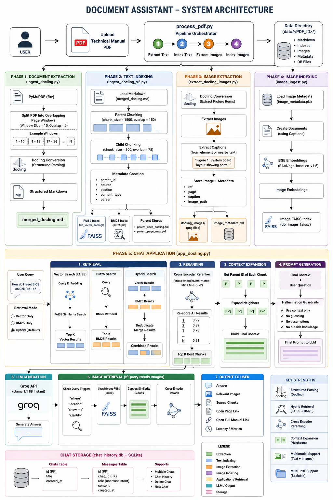

# Document Assistant – Hybrid RAG Chatbot

A Retrieval-Augmented Generation (RAG) chatbot designed for technical manuals and documentation. The system combines semantic search, keyword search, reranking, and image retrieval to provide accurate, source-grounded answers from uploaded PDF documents.

---

## Features

* Structured PDF parsing using Docling
* Hybrid Retrieval (FAISS + BM25)
* Cross-Encoder Reranking
* Parent-Child Chunking Strategy
* Image Extraction and Retrieval
* Source Attribution
* Context Expansion
* Multi-PDF Processing Pipeline
* Hallucination Guardrails
* Streamlit Chat Interface

---

## System Architecture



---

## Technology Stack

### Document Processing

* PyMuPDF (fitz)
* Docling

### Retrieval

* FAISS
* BM25 Retriever
* BAAI/bge-base-en-v1.5 Embeddings

### Reranking

* cross-encoder/ms-marco-MiniLM-L-6-v2

### LLM

* Groq API
* Llama 3.1 8B Instant

### Frontend

* Streamlit

---

## Project Structure

```text
CHATBOT_RAG/
│
├── app_docling.py
├── process_pdf.py
├── ingest_docling.py
├── ingest_docling_v2.py
├── extract_docling_images.py
├── image_ingest.py
├── config.py
├── db.py
├── requirements.txt
├── README.md
│
├── docs/
│   ├── architecture.png
│   └── DESIGN_DECISIONS.md
│
└── source_docs/
```

---

## Retrieval Pipeline

### 1. PDF Processing

The uploaded PDF is processed through a multi-stage pipeline:

```text
PDF
 ↓
Docling Extraction
 ↓
Structured Markdown
 ↓
Parent Chunking
 ↓
Child Chunking
 ↓
Metadata Generation
```

---

### 2. Text Indexing

The system creates:

* FAISS Vector Index
* BM25 Keyword Index
* Parent Document Store

---

### 3. Query Processing

```text
User Query
    ↓
FAISS Retrieval
    +
BM25 Retrieval
    ↓
Hybrid Candidate Set
    ↓
Cross Encoder Reranking
    ↓
Parent Context Expansion
    ↓
LLM Response Generation
```

---

### 4. Image Retrieval

When image-related queries are detected, the system:

1. Searches image captions
2. Retrieves relevant images
3. Reranks image matches
4. Returns supporting visuals alongside the answer

---

## Installation

### Clone Repository

```bash
git clone <your-repository-url>
cd CHATBOT_RAG
```

### Create Virtual Environment

```bash
python -m venv venv
```

### Activate Environment

Windows:

```bash
venv\Scripts\activate
```

Linux/Mac:

```bash
source venv/bin/activate
```

### Install Dependencies

```bash
pip install -r requirements.txt
```

---

## Configuration

Create a `.env` file and configure your API keys:

```env
GROQ_API_KEY=your_api_key
```

Update paths and settings in:

```text
config.py
```

---

## Processing a PDF

Place PDF files inside:

```text
source_docs/
```

Run:

```bash
python process_pdf.py
```

This will:

1. Extract structured text
2. Build vector indexes
3. Build BM25 indexes
4. Extract images
5. Index image captions

---

## Running the Application

```bash
streamlit run app_docling.py
```

Open the local Streamlit URL in your browser.

---

## Example Questions

### Technical Procedures

```text
How do I install the I/O-board FPC cable?
```

```text
How do I enter BIOS Setup?
```

```text
How do I drain flea power?
```

### Hardware Information

```text
Where is the battery located?
```

```text
Show me the system board.
```

### Specifications

```text
What are the keyboard shortcuts?
```

```text
What are the memory specifications?
```

---

## Design Decisions

Design rationale and architecture tradeoffs are documented in:

```text
docs/DESIGN_DECISIONS.md
```

---

## Future Improvements

* Exact page-level citations
* Metadata filtering
* Table-aware retrieval
* Multimodal embeddings
* Evaluation dashboard
* Access control for enterprise documents

---

## Disclaimer

This project is intended for educational and research purposes. Ensure you have appropriate rights to any documents processed by the system.

---

## Author

Built as a Hybrid RAG Document Assistant for technical manual question answering and multimodal retrieval.
